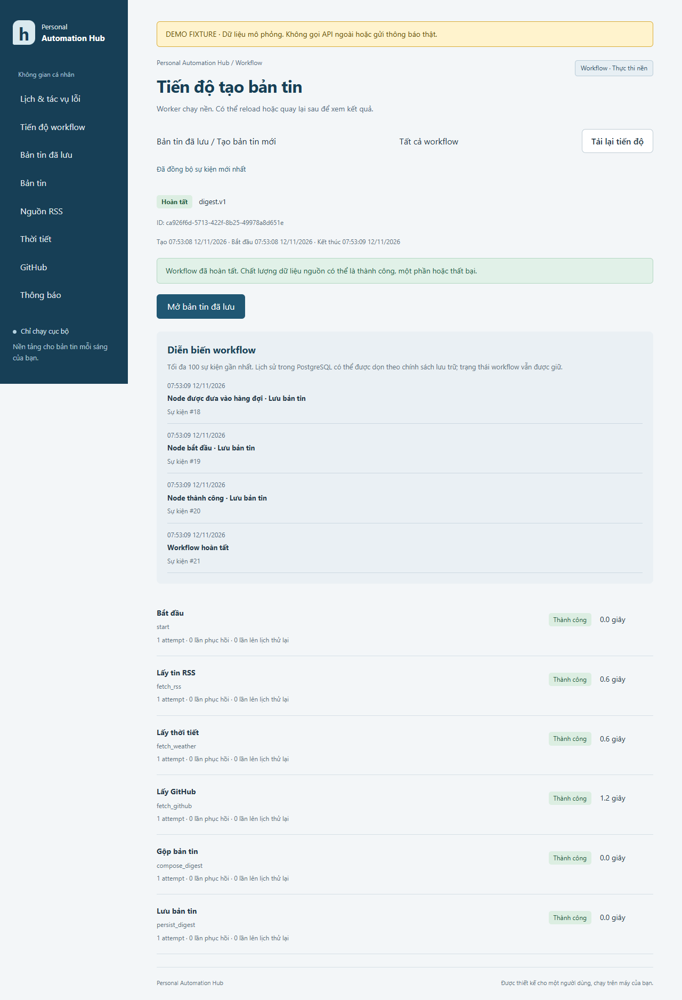
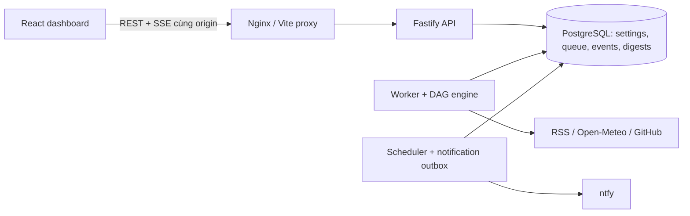
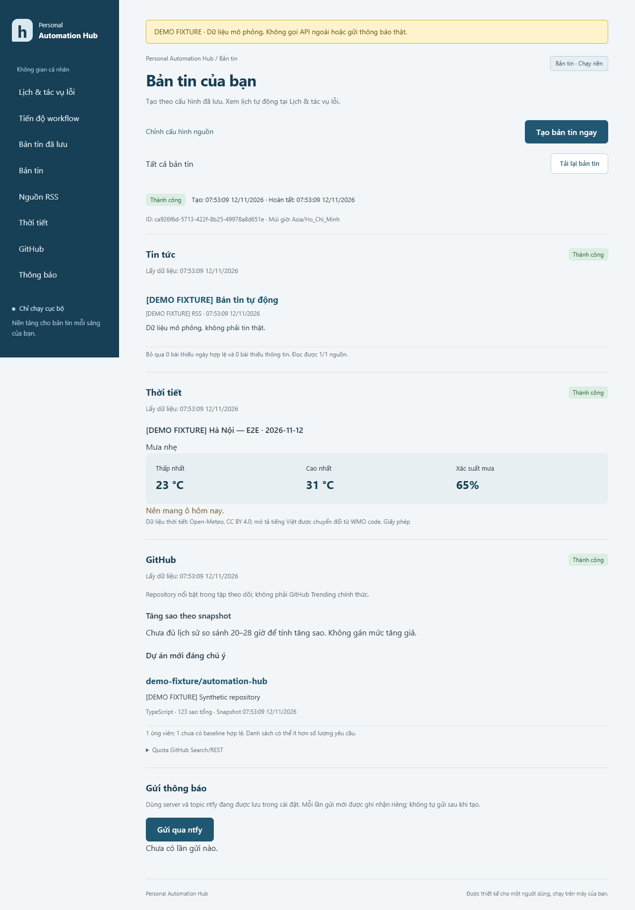

# Personal Automation Hub — v1.0.0 (bản chuẩn bị phát hành)

Dashboard cá nhân cho bản tin buổi sáng, tự host và không phụ thuộc dịch vụ trả phí.

Giá vàng/USD có thêm mức bán thấp nhất đã ghi nhận trong 30 ngày trước để so sánh. Khi đủ lịch sử và giá chạm đáy, scheduler kiểm tra mỗi 30 phút và gửi thông báo **KHẨN** qua ntfy. Xem [cách tính, thời gian tích lũy lịch sử và cảnh báo](docs/gold-usd.md#so-sánh-đáy-30-ngày-và-cảnh-báo-khẩn).

**Bản cục bộ để xem xét, chưa phát hành.** Cài mới và fixture tests đã qua; tích hợp live/ba buổi sáng còn chờ xác minh. Xem [release-readiness](docs/release-readiness.md), [CHANGELOG](CHANGELOG.md), [CV/GitHub description](docs/portfolio.md) và [checklist ba sáng](docs/morning-checklist.md).

## Vấn đề và cách giải quyết

Thay vì mở nhiều nguồn mỗi sáng, người dùng chọn RSS, tọa độ thời tiết và chủ đề GitHub một lần. Hub tạo bản tin theo yêu cầu hoặc lịch địa phương, lưu lịch sử và gửi thông báo ngắn qua ntfy. Lỗi một nguồn không làm mất kết quả của nguồn khác.

Phần trọng tâm kỹ thuật là một DAG engine TypeScript thuần, queue PostgreSQL có lease/fencing, retry và DLQ replay, cùng telemetry SSE lưu bền vững. PostgreSQL giữ trạng thái để tiếp tục sau worker crash. React/Vite/Tailwind dùng contracts Zod chung với Fastify; Docker Compose chỉ mở dashboard trên localhost.



*Ảnh từ luồng đã chạy trên database thử. Banner vàng và nhãn DEMO FIXTURE phân biệt dữ liệu mô phỏng với nguồn thật.*

## Quick start cho portfolio (không cần secret)

Cần Docker Desktop Linux containers. Chạy từ thư mục gốc:

```powershell
docker compose -f tests/portfolio/compose.yaml up -d --build --wait
```

Mở [demo cục bộ](http://127.0.0.1:8099), sửa/lưu cấu hình hoặc bấm **Bản tin đã lưu → Tạo bản tin ngay**. Demo dùng database/volume riêng, mọi HTTP được inject fixture, không gọi dịch vụ ngoài hoặc gửi thông báo thật. Dừng bằng `docker compose -f tests/portfolio/compose.yaml stop` để giữ dữ liệu. Ứng dụng dùng nguồn thật và các cách development/full Docker được hướng dẫn bên dưới.



Tài liệu portfolio: [kiến trúc và tính đúng đắn](docs/architecture.md), [kết quả kiểm chứng bước 6](docs/verification-step6.md), [benchmark và dữ liệu thô](docs/benchmark-step6.md), [backup/restore và retention](docs/operations.md), [kịch bản video và CV bullets](docs/demo.md).

| Benchmark fixture đã đo | Concurrency 1 | Concurrency 3 |
| --- | ---: | ---: |
| Số mẫu (không gồm warm-up) | 12 | 12 |
| Workflow median / p95 | 910,89 / 924,27 ms | 486,01 / 500,40 ms |
| Throughput một run tại một thời điểm | 1,095 run/s | 2,055 run/s |

Cùng DAG, HTTP fixture 200 ms/request; không phải số liệu API production. Event timestamp → DOM qua Nginx: median 334 ms, p95 499 ms, 53 event từ 3 run fixture riêng. Phương pháp và giới hạn đo nằm trong báo cáo benchmark. Đã qua 61 unit test và 40 integration test PostgreSQL, cộng browser flow desktop/mobile; chưa xác minh push điện thoại thật hoặc chạy lịch qua đêm.



## Phạm vi bước 1–6

Bước 1: chỉnh năm nhóm cấu hình, validate hai phía, lưu nguyên tử vào PostgreSQL và giữ dữ liệu qua reload/restart.

Bước 2: lấy RSS/thời tiết/GitHub và lưu bản tin. Bước 3: DAG thuần TypeScript và PostgreSQL queue, API trả 202/run ID, worker riêng có lease/heartbeat/phục hồi, dashboard theo dõi tiến độ. Bước 4: retry với backoff/jitter, DLQ và scheduler hằng ngày theo múi giờ, tự gửi ntfy cho run theo lịch. Bước 5: event store PostgreSQL và SSE có cursor/replay, timeline và reconnect. Bước 6: kiểm chứng toàn hệ thống, benchmark fixture tái lập, backup/restore, retention và portfolio. Chưa có Cron expression tùy ý hoặc webhook.

**Chỉ dùng trên localhost. Chưa có xác thực hoặc TLS; không đưa trực tiếp lên Internet, không mở port qua router/tunnel.**

## Yêu cầu

- Windows PowerShell 7 hoặc Windows PowerShell 5.1.
- Khi chạy development/test trên host: Node.js 24 LTS, pnpm **11.25.0** (cài bằng `npm install --global pnpm@11.25.0`).
- Docker Desktop đang chạy Linux containers và Docker Compose v2.
- Port mặc định: web dev 5173, API dev 3001, PostgreSQL dev 54329, web Docker 8088.

Dependency trực tiếp được khóa phiên bản trong manifest, dependency bắc cầu được khóa trong pnpm-lock.yaml. Vite scaffold theo [hướng dẫn chính thức](https://vite.dev/guide/), Tailwind dùng [Vite plugin](https://tailwindcss.com/docs/installation/using-vite). pnpm chỉ cho phép script cài đặt của esbuild.

## Chuẩn bị môi trường

Chạy từ thư mục gốc:

```powershell
# Mở PowerShell tại thư mục gốc của repository.
if (!(Test-Path .env)) { Copy-Item .env.example .env }
```

Chỉnh .env trước khi khởi tạo database lần đầu. Mật khẩu mẫu chỉ dùng phát triển cục bộ; hãy chọn mật khẩu riêng. Với cách nội suy URL trong Compose hiện tại, dùng mật khẩu gồm chữ, số, dấu gạch ngang hoặc gạch dưới. Giữ POSTGRES_USER, POSTGRES_PASSWORD, POSTGRES_DB đồng bộ với DATABASE_URL. URL dùng với pnpm phải trỏ tới 127.0.0.1:54329; đổi DB_PORT thì sửa cả DATABASE_URL.

Không dùng tiền tố VITE_ cho secret. NTFY_TOKEN và GITHUB_TOKEN chỉ thuộc môi trường backend. Không lưu token trong cấu hình hoặc trả về trình duyệt.

Nếu volume đã có dữ liệu, thay POSTGRES_PASSWORD trong .env **không thay mật khẩu role PostgreSQL hiện tại**. Dùng lại thông tin đúng của volume; không xóa volume để xử lý lỗi đăng nhập.

## Cách 1: PostgreSQL Docker, web/API/worker pnpm

```powershell
pnpm install --frozen-lockfile
docker compose --env-file .env -f infra/compose.yaml -f infra/compose.dev.yaml up -d --wait db
pnpm migrate
pnpm dev
```

Mở [dashboard development](http://127.0.0.1:5173). Vite proxy /api đến 127.0.0.1:3001; trình duyệt chỉ dùng cùng origin. Không cần CORS. Nếu đổi port API, sửa cả target proxy trong apps/web/vite.config.ts.

Migration là lệnh tường minh khi development: luôn chạy `pnpm migrate` trước API khi cài mới hoặc có migration mới. Chạy lại không reset cấu hình.

Kiểm tra tại terminal khác:

```powershell
Invoke-RestMethod http://127.0.0.1:5173/api/health
Invoke-RestMethod http://127.0.0.1:5173/api/ready
```

pnpm dev chạy API, web, worker và scheduler riêng song song. Có thể chạy từng terminal bằng pnpm --filter @hub/api dev, pnpm --filter @hub/web dev, pnpm dev:worker và pnpm dev:scheduler.

Dừng các tiến trình pnpm bằng Ctrl+C; dừng database mà giữ dữ liệu:

```powershell
docker compose --env-file .env -f infra/compose.yaml -f infra/compose.dev.yaml stop db
```

## Cách 2: Toàn bộ bằng Docker Compose

Chỉ cần Docker và .env; không cần node_modules trên host:

```powershell
docker compose --env-file .env -f infra/compose.yaml up -d --build --wait
docker compose --env-file .env -f infra/compose.yaml ps
```

Mở [dashboard Docker](http://127.0.0.1:8088). Nginx phục vụ frontend và proxy /api đến API nội bộ. Chỉ publish web tại 127.0.0.1:8088, không publish API, worker hoặc database. Database dùng named volume `personal-automation-hub_hub_data`.

Migration tự chạy trước API. API chạy bằng user node không có quyền root. Backend TypeScript được thực thi bằng tsx sau khi typecheck trong bước build. Chạy lại migration khi cần:

```powershell
docker compose --env-file .env -f infra/compose.yaml run --rm migrate
```

Dừng toàn bộ, giữ volume:

```powershell
docker compose --env-file .env -f infra/compose.yaml stop
```

Có thể dùng `down` để gỡ container/network và vẫn giữ named volume. **Không dùng `down -v` hoặc xóa volume nếu muốn giữ cấu hình.** Khi chuyển từ dev sang full Docker, dùng lệnh với file base để bỏ port publish database; không cần xóa dữ liệu. Dừng stack cũ trước khi chuyển chế độ để tránh kết nối bị gián đoạn trong lúc container database được tạo lại.

## Kiểm tra

```powershell
pnpm typecheck
pnpm build
pnpm test
```

Integration test cần PostgreSQL thật đang chạy và quyền tạo schema trong database development. Test chỉ tạo và dọn schema ngẫu nhiên riêng; không sửa bảng cấu hình của ứng dụng, không xóa database hoặc volume. Không trỏ TEST_DATABASE_URL vào production.

Nếu đang chạy full Docker, dừng stack rồi bật database theo chế độ development để có port localhost:

```powershell
docker compose --env-file .env -f infra/compose.yaml stop
docker compose --env-file .env -f infra/compose.yaml -f infra/compose.dev.yaml up -d --wait db
$env:TEST_DATABASE_URL = (Get-Content .env | Where-Object { $_ -match '^DATABASE_URL=' }) -replace '^DATABASE_URL=', ''
pnpm test:integration
Remove-Item Env:TEST_DATABASE_URL
```

Các test xác minh validation, URL RSS chuẩn hóa/trùng, tọa độ, thời gian/múi giờ, tag rỗng/trùng, từ chối token trong payload; API lưu/đọc đủ năm nhóm, khởi tạo lại API vẫn còn dữ liệu, PUT sai không đổi dữ liệu, rollback lỗi PostgreSQL, migration chạy lại đồng thời giữ dữ liệu, health và readiness độc lập.

Kiểm tra trình duyệt: sửa năm nhóm → lưu → reload; thử latitude 91; tạo hai RSS cùng URL; kiểm tra thông báo tại trường. Tắt API rồi lưu bản nháp để xác nhận đầu vào vẫn còn khi thất bại. Kiểm tra desktop và mobile. Kết quả lần xác minh hiện tại ở [docs/verification.md](docs/verification.md).

## API và quy tắc dữ liệu

- GET /api/health: kiểm tra tiến trình, độc lập database.
- GET /api/ready: SELECT 1, trả 503 nếu database không sẵn sàng. Endpoint này không xác nhận migration; phải migrate trước khi dùng settings.
- GET /api/settings: toàn bộ cấu hình.
- PUT /api/settings: nhận đầy đủ năm nhóm, validate độc lập, UPDATE trong transaction và trả cấu hình đã chuẩn hóa. Không hỗ trợ PATCH.

Lỗi có dạng `{ error: { code, message, issues: [{ path: ["weather", "latitude"], message }] } }`. Validation trả 400. Lỗi nội bộ trả thông báo chung, không trả stack trace, connection string hoặc token. Payload tối đa 256 KiB.

RSS chỉ nhận HTTP/HTTPS, không chứa username/password. Chuẩn hóa bằng WHATWG URL: trim, chuẩn hóa hostname/protocol và port mặc định, bỏ fragment, sắp query, bỏ dấu / cuối đường dẫn trừ root. Giữ chữ hoa/thường trong path, giữ khác biệt HTTP/HTTPS và www. URL trùng bị từ chối kể cả nguồn đang tắt. Chỉ truy cập feed khi người dùng tạo bản tin, với chính sách chống SSRF.

Tag GitHub phân cách bằng dấu phẩy trên UI; trim, bỏ rỗng và trùng không phân biệt hoa/thường, giữ cách viết đầu tiên. Khi bật thời tiết phải có tên địa điểm, khi bật ntfy phải có topic. Tọa độ vẫn được validate khi mục tắt.

Mặc định: bản tin bật, 07:00 Asia/Ho_Chi_Minh; tích hợp tắt, RSS rỗng, repositoryCount 5.

## Giới hạn

Single-user, chưa có xác thực, chỉ localhost. Worker khôi phục job mất lease; node đã commit thành công không chạy lại. Job có thể thực thi lại sau sự cố nên chỉ đảm bảo at-least-once. ntfy hỗ trợ gửi thủ công và gửi sau run theo lịch; gửi lỗi/unknown không tự gửi lại.

Hai tab sửa settings dùng lần lưu cuối thắng; run đã tạo giữ cấu hình snapshot riêng. Có backup/restore PowerShell và retention theo batch/dry-run; chưa tự chạy các tác vụ này. Image theo tag ổn định có thể nhận bản vá, dependency pnpm khóa trong lockfile.

## Tạo và gửi bản tin đầu tiên

1. Nâng cấp bằng migration mới, giữ nguyên volume và file .env hiện có. Development chạy pnpm migrate rồi pnpm dev; full Docker dùng lệnh up --build --wait phía trên để migration tự chạy. Không sửa 001_settings.sql.
2. Mở dashboard, chọn **Chỉnh cấu hình nguồn**. Bật ít nhất một RSS, thời tiết hoặc GitHub, nhập thông tin và **Lưu cấu hình**. RSS cần HTTP/HTTPS công khai; thời tiết nhập tọa độ và tên địa điểm; GitHub có thể nhập topic/language. Thay đổi chưa lưu không được dùng khi tạo.
3. Vào **Bản tin đã lưu**, bấm **Tạo bản tin ngay**. API trả 202 cùng run ID và mở trang tiến độ. Worker chạy ba nguồn; trang nhận tiến độ qua SSE và dừng stream khi đã đồng bộ run completed/failed. Reload vẫn xem được. Khi hoàn tất, bấm Mở bản tin đã lưu để xem nội dung và chất lượng từng nguồn.
4. Muốn push: trong Thông báo, bật ntfy, lưu server URL và topic đang đăng ký trên điện thoại. Nếu cần, đặt NTFY_TOKEN trong .env rồi restart API và scheduler. Run theo lịch tự gửi sau khi lưu; run thủ công dùng nút **Gửi qua ntfy**. Không gửi toàn bộ bản tin dài.
5. Chỉ cấu hình PUBLIC_BASE_URL khi có URL dashboard điện thoại truy cập được; localhost/loopback không được gắn vào push. Có thể bỏ trống để chỉ gửi văn bản. PUBLIC_BASE_URL không mở cổng hay triển khai hosting.

Cờ Bật bản tin, giờ gửi và múi giờ điều khiển scheduler; thao tác tạo thủ công chỉ yêu cầu có nguồn dữ liệu bật. Các nguồn tắt được ghi disabled. Khi chưa có snapshot nền 20–28 giờ, GitHub chỉ hiển thị **Dự án mới đáng chú ý** được tạo trong 30 ngày, không có số tăng sao giả; có thể trả ít kết quả hơn cấu hình.

## Biến môi trường bước 2

| Biến | Mặc định / ý nghĩa |
| --- | --- |
| GITHUB_TOKEN | Trống; token tùy chọn để gọi GitHub. Chỉ backend đọc, không lưu vào bản tin. |
| NTFY_TOKEN | Trống; token ntfy tùy chọn, chỉ gửi trong Authorization header backend. |
| PUBLIC_BASE_URL | Trống; URL HTTP/HTTPS điện thoại truy cập được để gắn link bản tin. |
| NTFY_ALLOWED_ORIGINS | Trống = chỉ public; danh sách origin chính xác cho ntfy LAN/loopback, có port, phân cách dấu phẩy. Ví dụ http://192.168.1.10:8080. Không áp dụng cho RSS; metadata/link-local vẫn bị chặn. |
| HTTP_TIMEOUT_MS | 6000; 1–15000 ms cho DNS/kết nối/body mỗi HTTP request. |
| DIGEST_TIMEOUT_MS | 25000; 1–45000 ms cho mỗi node thu thập; chụp trong workflow lúc submit. Run có thể lâu hơn do chờ queue hoặc phục hồi. |
| MAX_CONCURRENT_OPERATIONS | 2; 1–4 lần gửi ntfy đồng thời ở API. Việc tạo chạy qua worker. |

File .env.example chỉ có placeholder. Giữ .env hiện có khi nâng cấp; thêm biến tùy nhu cầu. Restart pnpm dev hoặc chạy lại Compose up -d để áp dụng. Nếu ntfy chạy trên host trong Docker, dùng địa chỉ LAN mà container truy cập được và allowlist đúng origin; 127.0.0.1 bên trong API container là container đó. Dùng HTTP trên LAN chỉ khi bạn chấp nhận môi trường mạng tin cậy; token qua HTTP không được mã hóa.

## API bản tin

- POST /api/digests: không body hoặc body {"workflowVersion":"digest.v1"}, header Idempotency-Key UUID. Lưu run/root job rồi luôn trả 202 với runId, status, statusUrl. Cùng key/cùng payload trả cùng run; khác payload trả 409.
- GET /api/runs?page=1&pageSize=10: danh sách run, pageSize tối đa 50.
- GET /api/runs/:id: trạng thái và thời điểm từng node, số attempt/recovery, lỗi sạch, digestId nếu đã lưu.
- GET /api/digests?page=1&pageSize=10: danh sách, hasMore; pageSize tối đa 50.
- GET /api/digests/:id: snapshot cấu hình, trạng thái/kết quả nguồn và các lần gửi.
- POST /api/digests/:id/notifications: không body, header Idempotency-Key UUID. Cùng digest/key không chủ động gửi lại; key mới là một lần gửi có chủ đích. HTTP 200 trả attempt, cần đọc status success/failed/unknown/sending, không suy kết quả ntfy từ HTTP 200.

Lỗi request dùng định dạng error của bước 1; lỗi nguồn nằm trong bản tin (partial/failed). Trả 429 khi gửi ntfy vượt concurrency của API. Frontend khóa thao tác đang gửi và giữ key trong sessionStorage khi request lỗi để thử lại cùng yêu cầu. Sau khi nhận 202, thao tác mới dùng key mới. Xóa sessionStorage/mở tab khác có thể tạo request mới; không coi đây là chống trùng theo ngày.

Không hứa exactly-once: ntfy có thể đã nhận nhưng API mất kết nối hoặc chưa lưu được kết quả. Attempt unknown/sending cần người dùng xem xét; gửi lại bằng key mới có thể tạo thông báo trùng. Lỗi push không làm bản tin failed hoặc mất dữ liệu.

## Nguồn dữ liệu và điều kiện dùng

- Open-Meteo: [API daily/timezone](https://open-meteo.com/en/docs), [điều kiện Free API](https://open-meteo.com/en/terms). Dùng cho cá nhân phi thương mại; giới hạn hiện công bố dưới 10000 request/ngày, 5000/giờ, 600/phút. Dữ liệu CC BY 4.0; dashboard ghi nguồn, link giấy phép và việc chuyển mô tả WMO sang tiếng Việt. Không dùng gói trả phí.
- GitHub: [Search repositories](https://docs.github.com/en/rest/search/search?apiVersion=2022-11-28#search-repositories), [rate limits](https://docs.github.com/en/rest/using-the-rest-api/rate-limits-for-the-rest-api), [xử lý rate limit](https://docs.github.com/en/rest/using-the-rest-api/best-practices-for-using-the-rest-api#handle-rate-limit-errors-appropriately). Search có quota riêng. Luôn đọc header thực tế; connector dừng gọi khi cooldown, node failed được queue retry sau thời điểm cho phép. Mỗi bản tin tối đa ba tổ hợp topic/language × hai truy vấn 100 ứng viên, không tải vô hạn. Cooldown trong connector là bộ nhớ; thời điểm retry của node failed lưu PostgreSQL, chưa phối hợp quota toàn cục giữa các worker.
- ntfy: [publish JSON](https://docs.ntfy.sh/publish/#publish-as-json), [access token](https://docs.ntfy.sh/publish/#access-tokens). Topic công khai nên khó đoán; gửi theo nút riêng hoặc outbox sau run theo lịch khi đã bật cấu hình.
- RSS: tôn trọng điều kiện của từng nhà xuất bản. Chỉ hiện tiêu đề/link/mô tả plain text ngắn, không AI, không render HTML nguồn.

Đã kiểm thử bằng fixture/mock cho HTTP; test tự động không gọi các dịch vụ bên ngoài. Integration dùng PostgreSQL thật với schema tạm riêng. Xem [kết quả bước 2](docs/verification-step2.md) và [kiến trúc](docs/architecture.md).

## Biến môi trường worker

| Biến | Mặc định | Ý nghĩa |
| --- | --- | --- |
| WORKER_CONCURRENCY | 3 | 1–16 job đang xử lý trên một worker; không claim quá số slot. DAG digest.v1 có tối đa 3 node ready/running mỗi run. |
| WORKER_LEASE_MS | 15000 | Lease 1–120 giây, theo clock PostgreSQL. |
| WORKER_HEARTBEAT_MS | 4000 | Heartbeat nối tiếp; phải nhỏ hơn một nửa lease. |
| WORKER_POLL_MS | 1000 | 100–10000 ms giữa các vòng claim/recover khi rỗng. |
| WORKER_MAX_RECOVERIES | 3 | 0–10 lần đưa job mất lease về queued, ngoài attempt đầu tiên; độc lập retry lỗi connector. |
| WORKER_SHUTDOWN_MS | 10000 | Đợi công việc khi SIGTERM/SIGINT, sau đó abort; entry point thoát cưỡng bức sau thêm tối đa 2 giây nếu đóng tài nguyên bị kẹt. |

Giữ .env hiện có; thêm biến từ .env.example khi cần, không ghi token vào workflow/settings. HTTP_TIMEOUT_MS và GITHUB_TOKEN dùng ở worker; NTFY_TOKEN/PUBLIC_BASE_URL chỉ dùng cho nút gửi ở API. Docker stop_grace_period mặc định 20 giây; nếu tăng shutdown thì tăng grace period trong Compose.

## Thử workflow và phục hồi worker

1. Bật và lưu ít nhất một nguồn. Bấm Tạo bản tin ngay, xem trang Tiến độ workflow. Các node có queued/running/succeeded/failed/skipped, thời lượng và lỗi. Workflow completed có thể tạo bản tin partial hoặc failed; đây là chất lượng nguồn, khác lỗi thực thi.
2. Dừng worker trước khi tạo để quan sát queue bền vững:

~~~powershell
docker compose --env-file .env -f infra/compose.yaml stop worker
~~~

Tạo một bản tin trên dashboard; run ở queued. Reload vẫn còn. Sau đó:

~~~powershell
docker compose --env-file .env -f infra/compose.yaml start worker
~~~

3. Để thử sự cố đang chạy, tạo run mới rồi khi một node running, kill worker:

~~~powershell
docker compose --env-file .env -f infra/compose.yaml kill -s SIGKILL worker
docker compose --env-file .env -f infra/compose.yaml up -d worker
docker compose --env-file .env -f infra/compose.yaml logs --tail 30 worker
~~~

Nếu restart policy đã khởi động lại worker thì lệnh up giữ nó chạy. Chờ lease hết (mặc định 15 giây từ heartbeat cuối), cộng poll và thời gian fetch. Node đã succeeded không fetch lại; node đang leased được attempt mới, UI tăng recovery. Thao tác kill cần đúng thời điểm; các nguồn nhanh có thể đã hoàn tất trước khi kill. Không xóa volume để thử. Bộ integration có fixture chặn tác vụ, kill process worker thật, chờ lease và xác minh tiếp tục, nên không phụ thuộc tốc độ Internet để kiểm tra tình huống này.

Khi chạy pnpm, có thể dừng/khởi động lại terminal worker; Ctrl+C là graceful shutdown, không tương đương kill cưỡng bức. API/web vẫn hoạt động khi worker dừng, request được lưu queued.

## State machine và bảo đảm

Run: queued → running → completed/failed. Node: pending → queued → running → succeeded/failed/skipped; dependency không đạt all_success dẫn tới skipped. Job: queued → leased → done/failed; hết lease thì về queued nếu còn lượt phục hồi. Attempt mất worker được ghi interrupted. Compose dùng all_settled, biểu diễn lỗi/output thiếu rõ ràng.

Claim dùng transaction ngắn với FOR UPDATE SKIP LOCKED; mọi chuyển trạng thái khóa run → job. Heartbeat/complete phải có token còn hợp lệ và lease chưa hết. Hoàn tất node/enqueue downstream/cập nhật run cùng transaction; unique logical jobs chống enqueue trùng. persist_digest cùng transaction ghi idempotent digest/snapshot sao và kiểm lease, không có HTTP trong transaction.

Không exactly-once execution: HTTP fetch chưa commit có thể chạy lại sau crash. Ghi bản tin có unique workflow_run_id, nên thực thi lại cùng run không tạo bản tin thứ hai. Replay từ DLQ tạo run mới và có thể tạo bản tin mới. ntfy dùng outbox riêng cho run theo lịch.

Bản tin cũ vẫn xem/gửi được, không tạo run lịch sử giả. Bản tin còn running từ luồng đồng bộ bước 2 không có queue/lease nên không được tự phục hồi; dùng request mới nếu muốn tạo lại. Nếu client gửi lại key thuộc bản tin bước 2, API trả 409 LEGACY_IDEMPOTENCY_KEY; mở bản tin cũ hoặc dùng key mới nếu muốn tạo thêm. Request bước 3 lưu payload chuẩn hóa, đổi settings không làm đổi run đã có.

Kết quả kiểm tra bước 3: [docs/verification-step3.md](docs/verification-step3.md). Xem [kiến trúc/state machine/lease](docs/architecture.md). Chưa có Cron expression tùy ý/webhook/editor DAG hoặc quota GitHub phối hợp nhiều worker; backup/retention thủ công có từ bước 6. Không có commit hoặc push tự động.

## Bước 4: retry, DLQ và bản tin mỗi sáng

Giữ nguyên .env và volume. Nâng cấp development: pnpm install, pnpm migrate rồi pnpm dev. Docker:

```powershell
docker compose --env-file .env -f infra/compose.yaml up -d --build --wait
```

Migration 004 chỉ thêm bảng/cột/index, không chỉnh migration cũ. Scheduler là service riêng. Trong cấu hình, bật Bản tin và ít nhất một nguồn, chọn giờ (mặc định 07:00 Asia/Ho_Chi_Minh), bật ntfy nếu muốn push rồi lưu. Xem **Lịch & tác vụ lỗi** và bấm Tải lại sau khoảng 5 giây để thấy lịch mới. Máy, database, worker và scheduler phải chạy; không dùng Codex Automations hoặc hosting bên ngoài.

Scheduler lưu next_run_at trong PostgreSQL; lần đầu/đổi giờ/múi giờ chỉ lên lịch cho tương lai. Lượt quá hạn tối đa 15 phút được chạy một lần, cũ hơn bị bỏ qua. Unique theo ngày địa phương ngăn tạo trùng ngay cả nhiều scheduler hoặc đổi giờ trong ngày; không áp dụng cho run thủ công. Lịch DST không tồn tại bị bỏ qua, giờ lặp chỉ tạo một run/ngày. Tắt bản tin ngăn lịch mới, không hủy run/outbox đã tạo với snapshot cũ. Thông báo thuộc lịch ngày cũ sẽ bị bỏ gửi tự động.

Node failed do timeout/mạng hoặc HTTP 408/425/429/500/502/503/504 được thử lại tối đa 3 lần ngoài attempt đầu. Backoff full jitter có trần 60 giây; Retry-After (giây hoặc HTTP date) và GitHub reset time được giữ làm thời điểm sớm nhất, có thể vượt trần jitter. Lưu available_at/retry_count bền vững; worker không ngủ giữ slot. HTTP 400/401/403 hoặc lỗi URL/chính sách không retry. Nguồn partial giữ kết quả và không fetch lại chỉ vì một feed lỗi. Chỉ sau terminal node thì all_settled mới ghép bản tin. Policy được worker đọc từ môi trường, thay đổi áp dụng cả job đang chờ.

Node failed hoặc hết lượt crash recovery vào DLQ, kể cả run hoàn tất với bản tin partial/failed. Nút Tạo run chạy lại tạo **toàn bộ workflow mới** với snapshot cũ, không sửa output đã tiêu thụ, không gửi ntfy tự động. Một mục DLQ trả cùng replay run khi bấm lặp; mỗi mục khác có thể tạo run riêng.

persist_digest ghi bản tin và outbox trong cùng transaction khi run theo lịch bật ntfy trong snapshot. Scheduler claim outbox trước khi gọi ntfy, dùng destination snapshot và key ổn định. Gửi lỗi hoặc ambiguous/unknown không tự retry, nhằm tránh chủ động gửi trùng. Sending quá 60 giây được đánh unknown; mở bản tin kiểm tra và gửi lại thủ công nếu cần. Không hứa exactly-once push. Link bản tin trên điện thoại cần PUBLIC_BASE_URL truy cập được; dự án vẫn chỉ bind localhost nên không tự tạo truy cập từ xa.

| Biến mới | Mặc định | Ý nghĩa |
| --- | --- | --- |
| WORKER_MAX_RETRIES | 3 | 0–10 retry lỗi node, riêng crash recovery |
| WORKER_RETRY_BASE_MS | 1000 | Trần jitter ban đầu |
| WORKER_RETRY_MAX_MS | 60000 | Trần jitter exponential, không cắt Retry-After |
| SCHEDULER_POLL_MS | 5000 | Chu kỳ kiểm tra lịch và outbox |
| SCHEDULER_GRACE_MS | 900000 | Cửa sổ chấp nhận lịch trễ; 0 bỏ mọi lịch trễ |

API mới: GET /api/schedule (lịch, heartbeat và 20 delivery gần nhất), GET /api/dead-letters?page=1&pageSize=10, POST /api/dead-letters/:id/replay (không body, 202/runId). Run node thêm retryCount/availableAt, vẫn dùng queued cho retry chờ. Trang lịch tải theo yêu cầu; từ bước 5 trang chi tiết run dùng SSE.

Kiểm chứng: [docs/verification-step4.md](docs/verification-step4.md).

## Bước 5: telemetry trực tiếp qua SSE

Không cần biến môi trường hoặc dịch vụ mới. Giữ nguyên `.env` và volume hiện có. Khi nâng cấp stack đang chạy, dừng các tiến trình ghi trước khi áp dụng migration 005:

```powershell
docker compose --env-file .env -f infra/compose.yaml stop web api worker scheduler
docker compose --env-file .env -f infra/compose.yaml up -d --build --wait
```

Migration tự chạy trước API/worker/scheduler. Development: dừng các terminal pnpm cũ, chạy `pnpm migrate` rồi `pnpm dev`. Không sửa migration 001–004, không dùng `down -v`.

Mở dashboard, tạo bản tin và vào trang tiến độ. Nhãn **Đang kết nối → Trực tiếp** cho biết kết nối SSE; timeline ghi thời gian tạo/chạy/kết thúc run, node, retry và phục hồi job. Tắt mạng rồi bật lại để nhận bù sự kiện. Reload vẫn đọc snapshot và lịch sử từ PostgreSQL. Khi run terminal đã đồng bộ, stream đóng và hiển thị **Đã đồng bộ sự kiện mới nhất**. Nút **Tải lại** vẫn lấy snapshot thủ công. Nguồn lỗi vẫn tuân theo quy tắc partial/failed hiện có; SSE không tự gửi ntfy.

API bổ sung, không thay endpoint REST hiện tại:

- `GET /api/runs/:id`: thêm `eventCursor`, `recentEvents` (100 sự kiện cuối), `eventsTruncated`.
- `GET /api/runs/:id/events?cursor=runUUID:sequence`: stream `text/event-stream`; `Last-Event-ID` ưu tiên hơn query cursor khi reconnect.
- Event `run-event` có `id` là cursor, dữ liệu gồm `id`, `runId`, `sequence` dạng chuỗi, `type`, `timestamp`, `nodeId`, `payload` projection trạng thái đã làm sạch.
- Event `sync` xác nhận watermark/terminal; `reset` yêu cầu lấy snapshot mới nếu cursor vượt watermark hoặc thiếu lịch sử. Hai control event không có ID. Cursor sai cú pháp hoặc thuộc run khác trả JSON 400; run không tồn tại trả 404 trước khi mở stream.

Ví dụ theo dõi một run hiện có trong PowerShell (thay UUID thật):

```powershell
$runId = 'THAY-BANG-UUID-CUA-RUN'
$run = Invoke-RestMethod "http://127.0.0.1:8088/api/runs/$runId"
$cursor = [uri]::EscapeDataString($run.eventCursor)
curl.exe -N "http://127.0.0.1:8088/api/runs/$runId/events?cursor=$cursor"
```

State và cursor được đọc cùng snapshot database; event và chuyển trạng thái commit cùng transaction dưới khóa run. Replay truyền lại có thể lặp sau reconnect; frontend bỏ trùng bằng sequence và lấy lại snapshot khi phát hiện gap. Không đảm bảo exactly-once delivery. Run cũ trước migration bắt đầu cursor 0, không dựng lại lịch sử giả.

Giới hạn mỗi API process: 100 stream / 50 run đang theo dõi, vượt trả 429; hub gom đọc mỗi 500 ms, batch 100 event/run, không giữ connection database cho từng client. Heartbeat 15 giây; buffer socket 64 KiB, chờ drain tối đa 10 giây rồi đóng để reconnect. Replay nhường I/O sau đợt khoảng 16 KiB. Frontend chỉ giữ/render 100 sự kiện, chỉ tự cuộn khi gần cuối. Event payload tối đa 4 KiB; không lưu input/output, token, header hoặc raw response. Có retention thủ công từ bước 6; event store vẫn tăng nếu không chạy dọn. Nginx tắt buffering/cache/gzip riêng cho SSE, timeout một giờ; vẫn cùng origin và chỉ localhost.

Kiểm tra bằng `pnpm typecheck`, `pnpm test`, `pnpm build` và `pnpm test:integration` với PostgreSQL thử riêng như phần kiểm tra. Suite mới dùng fixture, kiểm tra rollback, race, cursor/replay/reset, retry/recovery/terminal, heartbeat và cleanup. Kết quả PostgreSQL, Nginx và trình duyệt: [verification-step5.md](docs/verification-step5.md). Thiết kế chi tiết: [architecture.md](docs/architecture.md).


## Bước 6: vận hành và áp dụng bản mới

Các lệnh nghiệm thu và demo dùng database riêng; stack chính chưa được nâng cấp trong lần bàn giao. Để áp dụng code hiện tại, bao gồm migration **006_retention.sql**, giữ `.env` và volume:

```powershell
docker compose --env-file .env -f infra/compose.yaml stop web api worker scheduler
docker compose --env-file .env -f infra/compose.yaml up -d --build --wait
```

Migration mới chạy trước API/worker/scheduler, không sửa migration cũ. Bản mới thêm log rotation khi recreate container. Development dừng tiến trình pnpm cũ, chạy `pnpm migrate` rồi `pnpm dev`.

Backup/restore PowerShell, retention mặc định dry-run và giới hạn lưu trữ: [operations.md](docs/operations.md). Script restore chỉ tạo database mới, không ghi đè. Kết quả 13 bảng đã restore/đối chiếu và phần chưa xác minh: [verification-step6.md](docs/verification-step6.md). Không chạy tác vụ xóa hoặc notification thật khi kiểm thử.

## Cài mới song song để xem xét v1.0.0

Dùng một thư mục source mới (không sao chép `.env`, `node_modules`, `dist`, `output` hoặc `.git` từ máy khác). Chạy tại thư mục gốc mới và thực hiện phần **Chuẩn bị môi trường**: sao chép `.env.example` thành `.env`, chọn POSTGRES_PASSWORD riêng và thay cùng giá trị trong DATABASE_URL. Chưa bật nguồn hoặc ntfy khi chỉ kiểm tra khởi động.

```powershell
$env:WEB_PORT = '8108'
docker compose -p hub-v1-review --env-file .env -f infra/compose.yaml up -d --build --wait
Invoke-RestMethod http://127.0.0.1:8108/api/ready
docker compose -p hub-v1-review --env-file .env -f infra/compose.yaml stop
Remove-Item Env:WEB_PORT
```

Project `hub-v1-review` có volume mới `hub-v1-review_hub_data`; port 8108 tránh đụng dashboard mặc định 8088. Không chạy lệnh stop/down trên project cá nhân để nghiệm thu. Mặc định WEB_PORT vẫn 8088; chỉ localhost. Chọn tên project khác nếu tên thử đã có dữ liệu. Cách này dùng đúng entry point API/worker/scheduler production; quick start fixture phía trên dùng adapter HTTP giả và có banner riêng.

Trạng thái bản chuẩn bị phát hành, quét secret/history, kiểm chứng cài mới và việc còn cần chủ repository thực hiện: [release-readiness.md](docs/release-readiness.md). Checklist ba buổi sáng: [morning-checklist.md](docs/morning-checklist.md). [CHANGELOG.md](CHANGELOG.md) mô tả phạm vi v1.0.0; chưa tạo tag/release hoặc công khai repository.
