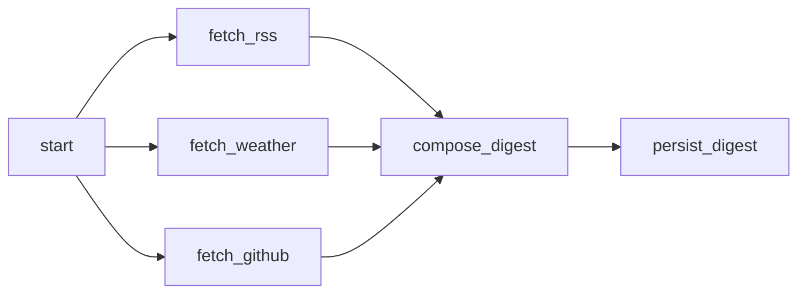

# Kiến trúc Personal Automation Hub, bước 1–6

## Thành phần và ranh giới

- **packages/engine**: TypeScript thuần, không HTTP/pg. Định nghĩa node/edge/config JSON, Kahn topo validation, plan các node ready/skipped theo concurrency và dependency policy. Output dependency luôn có status/output/error; thiếu dữ liệu là null và lỗi rõ ràng.
- **packages/contracts**: cấu hình Zod, hợp đồng bản tin và run, pagination, UUID/idempotency key. Chỉ hỗ trợ workflowVersion digest.v1; không có API định nghĩa DAG tùy ý.
- **apps/api**: Fastify nhận request và lưu run/root job; đọc tiến độ/lịch sử; giữ API cài đặt, xem bản tin và gửi ntfy thủ công. Không lấy RSS/thời tiết/GitHub trong request tạo.
- **apps/worker**: tiến trình riêng, dùng WorkflowQueue và DigestNodeExecutor trong backend để tái sử dụng connector, baseline GitHub và quy tắc tổng hợp từ bước 2. Worker không tự gửi ntfy.
- **PostgreSQL**: nguồn trạng thái duy nhất. Các bảng cũ giữ nguyên; migration 003 thêm workflow_runs, node_runs, workflow_jobs, execution_attempts và liên kết digest. Không dùng bộ nhớ để quyết định một node đã hoàn thành hay chưa.

## Workflow cố định

Snapshot digest.v1 lưu trong mỗi run, concurrency DAG = 3. Node chứa ID/type/config/policy. Ba nhánh nguồn độc lập. all_success chờ mọi dependency terminal và chỉ chạy khi tất cả succeeded; nếu không thì skipped, lan truyền qua downstream. compose_digest dùng all_settled, nhận cả failed/skipped và output null. Nguồn cấu hình tắt được executor đánh skipped/SOURCE_DISABLED, không gọi connector; khi gộp giữ SourceResult disabled. Dependency gián đoạn/không có output trở thành nguồn failed/MISSING_SOURCE_OUTPUT hoặc lỗi phục hồi cụ thể, không giả lập nguồn thành công.

Workflow hoàn tất khi persist_digest succeeded, kể cả chất lượng bản tin là partial hoặc failed. Nếu persist không thể ghi hoặc bị skip, execution run failed. Từ bước 4, lỗi tạm thời được queue lại với available_at; chỉ terminal sau khi hết retry. Crash recovery riêng cho job mất lease.

## State machine

| Đối tượng | Chuyển trạng thái |
| --- | --- |
| Run | queued → running → completed / failed |
| Node | pending → queued → running → succeeded / failed / skipped |
| Node khi dependency không đạt | pending → skipped |
| Job | queued → leased → done / failed |
| Job mất lease, còn hạn phục hồi | leased → queued, cùng job ID và logical node |
| Job mất lease, hết lượt phục hồi | leased → failed; node failed/RECOVERY_LIMIT |
| Attempt | running → succeeded / failed / skipped / interrupted |

Node thành công/failed/skipped là terminal, không chạy lại chỉ vì worker restart. Mỗi claim tạo attempt mới; node.started_at là lần bắt đầu đầu tiên, completed_at là lần terminal. Thời lượng UI là elapsed từ lần đầu, có thể gồm gián đoạn/đợi phục hồi. Attempt lưu thời gian từng lần, worker và token riêng. Các job đã failed do connector không nằm trong tập thu hồi.

## API, snapshot và idempotency

POST /api/digests chấp nhận không body hoặc {workflowVersion: digest.v1}; chuẩn hóa cùng payload. Header Idempotency-Key UUID bắt buộc. Transaction dùng advisory lock theo key, kiểm request cũ, đọc/validate settings, lưu workflow và cấu hình snapshot, tạo sáu node và root job. Cùng key/cùng payload trả cùng run; payload khác trả 409. Unique constraints bảo vệ thêm run key, (run,node), logical job và một digest/run. Cấu hình thay đổi sau submit không tác động run đó. Token chỉ đọc ở môi trường API/worker, không nằm trong snapshot.

API trả HTTP 202 cùng runId/status/statusUrl. GET /api/runs có phân trang (pageSize tối đa 50); GET /api/runs/:id trả trạng thái, node, thời gian, lỗi, số attempt/recovery và digestId. Không trả claim token hoặc payload output lớn cho dashboard. Snapshot/input/output vẫn lưu trong PostgreSQL để thực thi tiếp.

Bản tin bước 2 giữ nguyên, tiếp tục xem/gửi ntfy; không tạo workflow lịch sử giả. Key đã thuộc bản tin cũ mà chưa có run trả 409 LEGACY_IDEMPOTENCY_KEY để client cũ không tạo bản tin trùng khi gửi lại. Muốn tạo thêm phải dùng key mới.

## Claim, heartbeat và race

Adapter thống nhất thứ tự khóa **run → job → node** trong transaction ngắn. Claim chọn run có job queued với FOR UPDATE SKIP LOCKED, rồi job cũng SKIP LOCKED; cập nhật worker_id, claim_token UUID và lease_until bằng clock_timestamp() của PostgreSQL, ghi attempt, commit. Chỉ sau commit worker mới thực thi. Clock của worker không quyết định lease.

Heartbeat là UPDATE job có điều kiện job ID, token, worker ID, status leased và lease chưa hết. Không gia hạn lease đã hết. Heartbeat chạy nối tiếp, không tạo request heartbeat chồng nhau. Mất token hoặc lỗi heartbeat khiến worker abort tác vụ khi có thể và không chủ động ghi output. Connector có signal/timeout; adapter vẫn kiểm token kể cả tác vụ không thể cancel.

Khi node xong: khóa run/job, kiểm token và hạn lease, ghi node/attempt, xác định downstream bằng engine, enqueue logical job unique và cập nhật run trong cùng transaction. Hai nhánh hoàn tất đồng thời phải đi qua cùng khóa run; nhánh sau nhìn thấy kết quả đã commit của nhánh trước, nên compose được tạo một lần và không có lost wakeup. Queued + running tính vào concurrency DAG.

Không giữ connection/transaction khi gọi HTTP. GitHub trả SourceResult và danh sách snapshot vào output node bền vững, chưa ghi github_snapshots. persist_digest đọc compose output, INSERT digest theo workflow_run_id unique và snapshot sao với ON CONFLICT DO NOTHING, nối digestId vào run trong cùng transaction còn lease. Final fence kiểm lại token/hạn lease và rollback cả digest/snapshot nếu lease đã hết trong lúc SQL chạy. Worker cũ trả muộn bị từ chối, kể cả chưa có worker mới claim.

## Thu hồi và shutdown

Mỗi vòng worker kiểm một run có lease hết hạn, khóa run/job với SKIP LOCKED, đánh attempt interrupted. Còn lượt thì giải phóng ownership, tăng recoveries và trả job/node về queued; hết lượt thì terminal failed với RECOVERY_LIMIT, rồi engine tiếp tục/skip downstream. Mặc định ba lượt phục hồi ngoài attempt đầu tiên. Các worker có thể cùng thu hồi an toàn nhờ khóa/điều kiện token. Nếu mọi worker dừng thì job vẫn được lưu, thu hồi diễn ra khi có worker chạy lại.

Worker chỉ claim khi còn slot cục bộ; poll rỗng mặc định một giây. SIGTERM/SIGINT dừng claim, đợi tác vụ tối đa WORKER_SHUTDOWN_MS, sau đó abort và dừng heartbeat. Entry point có hạn cứng thêm hai giây cho đóng tài nguyên; nếu buộc thoát, transaction chưa commit bị PostgreSQL rollback và job còn lease sẽ được phục hồi. Compose stop_grace_period 20 giây phù hợp mặc định; nếu tăng shutdown phải tăng grace period tương ứng.

## Các giới hạn thực thi

**At-least-once, không exactly-once execution.** Worker có thể fetch lại nhánh chưa commit output khi chết. Node terminal đã commit không fetch lại. Ghi digest/snapshot idempotent và có fencing; không hứa một HTTP fetch chỉ xảy ra một lần. Bước 4 thêm retry/backoff/DLQ/lịch hằng ngày; bước 5 thêm SSE. Chưa có Cron expression tùy ý hoặc webhook.

DIGEST_TIMEOUT_MS giờ là giới hạn thu thập cho từng node nguồn, được chụp trong workflow. HTTP_TIMEOUT_MS vẫn giới hạn mỗi request. Thời gian run bao gồm chờ queue, node tuần tự nếu worker ít slot và thời gian phục hồi; không phải một deadline wall-clock cho toàn run. Cùng một node được phục hồi có budget thực thi mới.

ntfy có nút gửi riêng và outbox cho run theo lịch, không nằm trong DAG. Giữ idempotency key riêng cho từng lần gửi; unknown/sending sau lỗi mạng/crash vẫn có thể xảy ra. Không tự gửi lại ntfy và không đảm bảo exactly-once push.

## Nguồn và bảo vệ dữ liệu giữ từ bước 2

RSS: HTTP/HTTPS public, DNS/IP pinning và kiểm redirect chống SSRF; ba feed đồng thời; response giới hạn 2 MiB, không DOCTYPE/ENTITY. Chọn 24 giờ, bỏ ngày thiếu và đếm, loại trùng GUID/URL/tracking, mười bài mới nhất, mô tả plain text.

Open-Meteo: ngày theo múi giờ bản tin, min/max Celsius, xác suất mưa, WMO code tiếng Việt, giữ null; attribution Open-Meteo/CC BY 4.0. GitHub: tối đa ba tổ hợp topic/language, mỗi tổ hợp hai trang 100 ứng viên (all-time và 30 ngày), không Trending chính thức. Snapshot nền gần 24 giờ trong cửa sổ 20–28 giờ, giữ mức tăng âm và khoảng thời gian thật; thiếu nền chỉ hiển thị dự án thực sự mới. Quota Search/core riêng, cooldown theo header trong bộ nhớ từng worker; chưa phối hợp quota giữa nhiều worker.

ntfy chỉ public trừ exact-origin allowlist LAN đã cấu hình; metadata/link-local vẫn bị chặn, POST không redirect. Không log Authorization/token/raw error/payload; .env không vào frontend hoặc build context. Secret có thể đổi qua môi trường khi restart mà không thay snapshot run.

## Vận hành

Docker: database healthy → migration hoàn tất → API/worker, web chờ API. Chỉ web publish localhost:8088; worker không có port HTTP. Dev override chỉ mở PostgreSQL localhost:54329. Named volume được giữ khi stop/down không kèm -v. Migration 001/002 không sửa; 003 thêm schema queue, chạy lại không reset dữ liệu. Từ bước 5 dashboard chi tiết nhận sự kiện qua SSE, dừng khi đã đồng bộ terminal.

Chưa có auth/TLS/public hosting hoặc dọn lịch sử tự động. Backup/restore và retention thủ công được bổ sung ở bước 6. Chỉ phục vụ localhost. Event store và SSE được mô tả ở phần bước 5 bên dưới.

## Bước 4 — Retry, dead letters và scheduler

Migration 004 thêm retry_count/available_at vào workflow_jobs, bảng dead_letters, digest_schedule và scheduled_deliveries. Node vẫn queued khi chờ retry, không được xem là terminal; all_settled chờ hết retry. Claim chỉ nhận job due theo clock PostgreSQL. Finish kiểm token rồi ghi attempt failed, queue lại và đặt available_at trong cùng transaction. Không sleep giữ worker slot. Backoff full jitter, server Retry-After/reset time là giới hạn sớm nhất. maxRetries độc lập recoveries. Lỗi permanent hoặc retry exhausted được ghi DLQ trong cùng transaction kết thúc node; recovery exhausted cũng vào DLQ.

DLQ replay khóa mục lỗi, tạo run mới bằng snapshot cũ, lưu replay_run_id trong cùng transaction. Bấm lại trả cùng run. Không reset node trong run terminal vì output cũ đã được downstream/bản tin sử dụng. Replay cả workflow, không tự gửi thông báo; run gốc và bản tin giữ nguyên.

apps/scheduler là tiến trình riêng. digest_schedule singleton được khóa SKIP LOCKED, dùng giờ database. Mỗi tick đọc settings; thay đổi giờ/múi giờ/active tính lần tương lai mới bằng Intl với timezone tường minh. Đây là lịch ngày theo giờ-phút, chưa phải Cron parser. Giờ DST không tồn tại bị bỏ; unique schedule_day đảm bảo một run cho một ngày địa phương kể cả giờ lặp hoặc đổi settings. Lần cũ quá SCHEDULER_GRACE_MS bị bỏ, không backfill. Tạo run/root job và cập nhật cursor trong cùng transaction; nhiều scheduler không tạo trùng. Không khóa settings trong lúc enqueue, tránh đảo thứ tự khóa với PUT settings. Snapshot source/destination chụp khi enqueue, không lấy secret.

persist_digest thêm scheduled_deliveries trong cùng transaction ghi bản tin nếu scheduled_at có giá trị và ntfy snapshot bật. Scheduler claim pending outbox thành sending, commit trước HTTP. DigestService nhận destination snapshot, dùng outbox ID làm idempotency key. Nhiều scheduler không chủ động gửi cùng outbox. Sending mất tiến trình quá 60 giây được đổi unknown; không gửi lại tự động, kể cả lỗi HTTP xác định. Request gửi thật có timeout tối đa 15 giây; không giữ transaction trong HTTP. Kết quả trả muộn sau khi đánh unknown không đổi notification attempt về success. Lượt thuộc lịch ngày cũ bị bỏ gửi, tránh backlog push sau khi máy tắt lâu.

Tắt lịch hoặc đổi ntfy chỉ tác động run tương lai, không hủy snapshot/outbox đã tạo. Manual notification vẫn dùng settings hiện tại. Không hứa exactly-once: process có thể mất phản hồi sau khi ntfy nhận. Người dùng kiểm tra điện thoại rồi gửi lại thủ công bằng key mới nếu cần. Outbox failure hiển thị riêng trên trang lịch, không biến thành lỗi bản tin và không replay qua DLQ node.

GET /api/schedule đọc cursor/heartbeat và 20 outbox gần nhất; GET /api/dead-letters có pagination; POST replay trả 202/runId. Run node trả retryCount/availableAt. Web thêm trang lịch/DLQ và thời điểm retry; bước 5 bổ sung SSE riêng cho chi tiết run.

## Bước 5: event store và Server-Sent Events

Migration 005_run_events.sql chỉ thêm event_sequence vào workflow_runs và bảng run_events; không sửa migration đã áp dụng. Mỗi event có run_id, sequence bigint tăng theo run, type, occurred_at timestamptz, node_id tùy chọn và payload JSONB tối đa 4096 byte. Khóa chính (run_id,sequence) vừa chống trùng vừa phục vụ đọc tiếp theo cursor. Counter được cập nhật dưới khóa run hiện có; event, counter và chuyển trạng thái cùng transaction, nên rollback không phát sinh event sai hoặc khoảng trống sequence.

Các type: run.created/started/completed/failed, node.queued/started/succeeded/failed/skipped/retry_scheduled và job.recovered. Retry phát node.retry_scheduled khi logical node về queued, chưa coi logical node terminal failed; attempt failed vẫn được lưu như bước 4. Recovery hết giới hạn phát job.recovered rồi node.failed với RECOVERY_LIMIT. Không phát heartbeat job thành event bền vững.

Payload chỉ chứa projection trạng thái/thời gian/counter của run và node liên quan. Không ghi settings, input/output node, snapshot repository, raw response, request header, token hoặc worker/claim token vào event. Lỗi chỉ lấy code trong allowlist và thông báo cố định, không sao chép message/raw error từ nguồn. Projection node không trả workerId/leaseUntil đang thay đổi theo heartbeat; REST snapshot vẫn giữ các trường hiện có để tương thích.

### Snapshot, cursor và replay

GET /api/runs/:id giữ nguyên các field cũ và thêm eventCursor, recentEvents (tối đa 100 event cuối, theo thứ tự tăng) và eventsTruncated. Run/nodes/counter/history được đọc trong transaction ngắn REPEATABLE READ READ ONLY rồi trả connection ngay. Một snapshot tương ứng một watermark event đã commit; không dùng hai SELECT READ COMMITTED rời rạc cho state/cursor.

Cursor opaque có dạng runUUID:sequence. Sequence gửi dưới dạng chuỗi để không mất chính xác ở JavaScript khi vượt MAX_SAFE_INTEGER. Cursor 0 hợp lệ. GET /api/runs/:id/events?cursor=... kiểm UUID và tồn tại run trước khi mở stream. Last-Event-ID có ưu tiên hơn query cursor khi browser tự reconnect; chỉ replay sequence lớn hơn cursor, theo đúng thứ tự. Event SSE dùng event: run-event và id là cursor; data là event contract JSON.

Sau khi bắt kịp watermark hiện tại, stream gửi event: sync với cursor và terminal. Control frame này không thay Last-Event-ID. Frontend chỉ đóng khi state terminal và cursor đã khớp sync terminal=true; server cũng kết thúc stream sau khi flush. Event đã commit giữa REST snapshot và lúc mở stream vẫn được replay. Frontend bỏ duplicate bằng sequence, phát hiện gap hoặc sai run rồi tải lại snapshot.

Cursor sai cú pháp/thuộc run khác trả 400 INVALID_EVENT_CURSOR JSON; run không tồn tại trả 404 trước headers SSE. Cursor đúng cú pháp nhưng lớn hơn watermark, hoặc phát hiện gap do dữ liệu không còn đủ, gửi event: reset (không có id) với code/snapshotUrl rồi đóng. Frontend đóng EventSource cũ, lấy snapshot mới và mở từ cursor mới. Bước 6 bổ sung retention theo batch; cursor hết hạn được reset như mô tả bên dưới. Run tồn tại trước migration bắt đầu ở cursor 0, lịch sử cũ không được dựng lại thành event giả.

### SSE hub và tài nguyên

Một hub cho mỗi API process, tối đa 100 subscriber và 50 run riêng biệt; quá giới hạn trả 429 SSE_CAPACITY trước khi mở. Một timer nối tiếp đọc mỗi 500 ms, gom cursor nhỏ nhất của các client cùng run vào một query PostgreSQL. Mỗi batch đọc tối đa 100 event/run; mỗi client nhận đợt tối đa khoảng 16 KiB trước khi nhường vòng I/O, tránh đóng nhầm client khỏe khi replay lịch sử dài. Không có transaction hoặc connection dành riêng cho client. Client mới vào trong lúc batch đang đọc được xử lý ở vòng tiếp theo.

Heartbeat SSE là comment mỗi khoảng 15 giây. Buffer socket giới hạn 64 KiB; khi write bị backpressure thì chờ drain và dừng gửi thêm cho client đó, không tạo hàng đợi payload trong bộ nhớ. Nếu không drain trong 10 giây hoặc vượt giới hạn thì đóng để client reconnect/replay. Ngắt client tháo close/error/drain listener; khi hub rỗng dọn timer. API preClose kết thúc stream trước khi đóng server/pool. Lỗi đọc database đóng stream để reconnect, không log raw error.

Mức trần batch tạm thời là 50 × 100 × 4 KiB payload, cộng envelope/object overhead; buffer active client tối đa 100 × 64 KiB. Đây là giới hạn của từng process, không phải quota dùng chung giữa nhiều API. Lịch sử PostgreSQL tăng theo số chuyển trạng thái và chưa được dọn tự động; cần theo dõi dung lượng ổ đĩa.

### Frontend và proxy

Chỉ trang chi tiết run chuyển sang EventSource: lấy snapshot một lần, dựng timeline gần nhất rồi mở từ eventCursor. Không gọi REST định kỳ cho tiến độ. Trạng thái hiển thị Đang kết nối/Trực tiếp/Đang kết nối lại/Đã đồng bộ sự kiện mới nhất. Khi offline chủ động đóng stream; online mở lại từ cursor đã xử lý cuối. Nếu EventSource đóng do HTTP/network fatal, timer reconnect riêng dùng cursor đó. Cleanup khi đổi trang dọn stream, listener online/offline và timer. Nút tải lại thủ công được giữ. Trang lịch/DLQ/danh sách không đổi sang SSE.

Chỉ giữ/render tối đa 100 event; tự cuộn chỉ khi đang cách cuối timeline dưới 64 px. Đồng hồ duration có timer UI riêng khi run running, không gọi REST. Snapshot chỉ lấy phần cuối lịch sử nên đồng bộ tới event mới nhất không có nghĩa là render toàn bộ event đã lưu.

Nginx có location riêng /api/runs/:id/events: HTTP/1.1, Connection header rỗng, proxy_buffering off, proxy_cache off, gzip off, timeout đọc/gửi một giờ. API gửi Cache-Control no-store/no-transform và X-Accel-Buffering no. Heartbeat giữ stream hoạt động; không cần CORS hoặc dịch vụ mới. Chỉ bind localhost như trước.

Tham chiếu giao thức: [WHATWG SSE/Last-Event-ID](https://html.spec.whatwg.org/multipage/server-sent-events.html), [Nginx proxy buffering](https://nginx.org/en/docs/http/ngx_http_proxy_module.html#proxy_buffering), [PostgreSQL isolation](https://www.postgresql.org/docs/17/transaction-iso.html).

## Bước 6 — Kiểm chứng, benchmark và vận hành

Mã nguồn bước 1–5 đã được đối chiếu và chạy lại trên DB thử riêng. Các adapter connector, engine, queue/lease/fencing, scheduler/outbox và event store được tái sử dụng nguyên kiến trúc. Fixture entry point trong operations/portfolio-server.ts là công cụ demo, không thay entry point production. Web chỉ bật banner khi build với VITE_DEMO_MODE=true; Compose chính không bật biến này. Không có secret ở biến VITE_.

Benchmark dùng WorkerRunner thật với cùng workflow digest.v1, chỉ đổi worker concurrency 1/3; HTTP fixture delay 200 ms/request, RSS/weather mỗi nhánh 1 request, GitHub 2 nối tiếp. Timing gồm submit/queue/parse/persist/quan sát terminal, một run tại một thời điểm. Không dùng kết quả này làm cam kết hiệu năng production. Xem benchmark-step6.md và JSON samples.

Migration 006 thêm events_pruned_through (watermark đã dọn), node_runs.attempts_pruned và partial index theo completed_at của run terminal. Retention mặc định dry-run; chỉ khóa một run completed/failed bằng SKIP LOCKED, giữ đúng thứ tự khóa run trước khi sửa lịch sử. Mỗi loại tối đa 1–1000 hàng/lần, trong một transaction; event 30 ngày và attempt log 90 ngày tính từ lúc run kết thúc. Không xóa queued/running hoặc bản tin. Tổng attempt UI là count còn lưu + attempts_pruned. Các counter retry/recovery và DLQ không bị reset. Rollback trả lại toàn bộ dữ liệu/counter/watermark nếu bất kỳ bước dọn nào lỗi.

Sequence event vẫn tăng, không tái sử dụng. Xóa prefix event và cập nhật floor cùng transaction. SSE đọc watermark, floor và batch event trong cùng một statement snapshot. Cursor < floor nhận reset/CURSOR_EXPIRED trước khi phát dữ liệu; cursor = floor được replay các event > cursor. Snapshot vẫn đọc state/cursor/history cùng REPEATABLE READ; sau khi dọn hết lịch sử, snapshot state đầy đủ và stream terminal sync vẫn hoạt động. Gap ngoài retention vẫn dùng EVENT_GAP; cursor tương lai vẫn CURSOR_OUT_OF_RANGE. Giao sự kiện là at-least-once, frontend dedup bằng sequence.

Dữ liệu event không được giữ mãi từ bước 6. Snapshot recentEvents có thể rỗng hoặc truncated do dọn; UI giải thích chính sách này. Không tự dọn hoặc scheduler retention trong nền. Node input/output, digest, snapshots GitHub, notification history và DLQ còn được giữ để replay/audit; dung lượng vẫn cần theo dõi. Process logs trong Compose chính rotate 10 MiB × 3 file/service, độc lập dữ liệu run.

Backup dùng pg_dump custom format và docker cp để không hỏng binary trong PowerShell. Restore chỉ tạo database hub_restore_* mới, không --clean/drop và không ghi đè. Đã đối chiếu count/hash 13 bảng trong database thử, bao gồm migration, state, cursor, event, digest và outbox. Đây là logical backup, không có PITR/role/global object hoặc tự động backup. Hướng dẫn: operations.md.

Bảo đảm quan trọng đã kiểm chứng: transaction/event rollback, run lock serialize hoàn tất song song, unique logical job/digest, token fencing sau lease, idempotency request/replay/notification, recovery khi kill worker process thật, snapshot-cursor không mất event và stale cursor reset sau retention. Giới hạn: không exactly-once HTTP/push, không HA/coordination quota GitHub giữa worker, chưa auth/TLS/public hosting, chưa soak/load test hoặc chờ lịch/điện thoại thật. Xem verification-step6.md để phân biệt code path fixture đã chạy với tích hợp ngoài chưa xác minh.

## DNS của API khi recreate container

Nginx trong Docker dùng resolver 127.0.0.11, cache DNS 5 giây, upstream api:3001 qua biến và truyền nguyên request_uri cho REST/SSE. Cấu hình cũ resolve API một lần khi Nginx khởi động, có thể trả 502 lâu dài sau khi API được recreate với IP khác; đã tái hiện ở môi trường cài mới v1.0.0. Có thể có lỗi thoáng qua lúc API đang đổi địa chỉ; frontend SSE reconnect/replay và nút tải lại vẫn dùng được khi API trở lại.

Test riêng `tests/portfolio/proxy-dns.ps1` chỉ nhận project hub-v1-review/hub-v1-demo. Nó giữ IP cũ bằng container timer fixture, recreate API stateless để buộc IP khác, kiểm tra web container không đổi và REST qua proxy phục hồi, rồi dọn container giữ IP của chính test. Không xóa DB/volume. Sau đó proxy-smoke kiểm event/cursor qua Nginx. Không dùng script này cho ứng dụng cá nhân/production.

Tham chiếu: [Nginx proxy_pass với biến và resolver](https://nginx.org/en/docs/http/ngx_http_proxy_module.html#proxy_pass), [resolver/valid](https://nginx.org/en/docs/http/ngx_http_core_module.html#resolver). Resolver này dành cho image Nginx chạy trong Docker network của Compose, không phải cấu hình Nginx trên host Windows.
